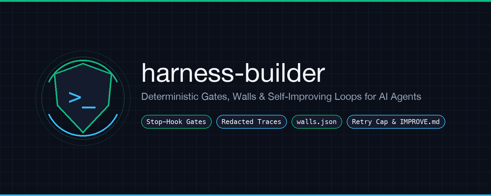
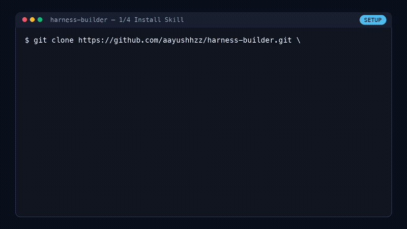
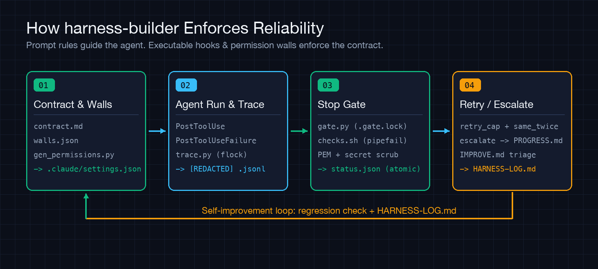
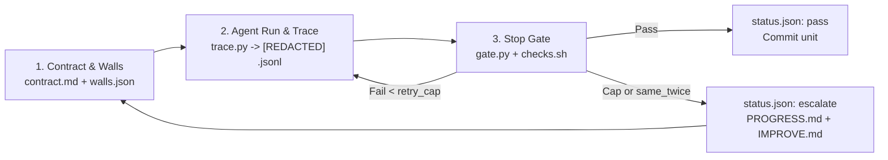

<p align="center">
  
</p>

<p align="center">
  <a href="https://github.com/aayushhzz/harness-builder/actions/workflows/ci.yml"></a>
  <a href="LICENSE"></a>
  
  
  <a href="https://github.com/aayushhzz/harness-builder/stargazers"></a>
</p>

<p align="center">
  <a href="#-demo">🎬 Demo</a> ·
  <a href="#️-why-harness-builder">🛡️ Why</a> ·
  <a href="#-how-to-use">🚀 How to Use</a> ·
  <a href="#️-architecture">🏗️ Architecture</a> ·
  <a href="#-repository-layout">📂 Layout</a> ·
  <a href="#-verification">✅ Verification</a>
</p>

---

**`harness-builder`** is an agent skill and hardened template kit for building reliable, self-improving agent harnesses across **Claude Code**, **Claude Agent SDK**, and **Managed Agents**.

Instead of relying on prompt-only reminders that agents drift from under pressure, `harness-builder` scaffolds deterministic **Stop-hook gates** (`checks.sh` + `gate.py`), **secret-redacted JSONL traces** (`trace.py`), **permission walls** (`walls.json` → `.claude/settings.json`), and a structured **post-failure triage loop** (`IMPROVE.md`).

---

## 🎬 Demo

<p align="center">
  
</p>

> 🎥 Prefer full-resolution video? Watch or download [`assets/demo.mp4`](assets/demo.mp4) (1280×720, 36s, 398 KB).

---

## 🛡️ Why `harness-builder`?

| Failure Mode | Prompt-Only Skills | `harness-builder` |
|---|---|---|
| 🚨 Agent declares `"Done!"` with failing tests | ❌ Relies on polite reminder | ✅ **Deterministic `Stop` hook** (`gate.py`) runs `checks.sh` and blocks exit |
| 🔁 Agent retries the same broken fix forever | ❌ Burns tokens in a loop | ✅ **`retry_cap` + `same_twice`** (timestamp/duration normalized) escalates cleanly |
| 🔑 Secrets leak into traces or `PROGRESS.md` | ❌ Raw tool output logged | ✅ **Recursive key/value + PEM/ANSI scrubbing** across `checks.sh`, `trace.py`, `gate.py`, `run.py` |
| 🧱 Agent edits test gates or `walls.json` | ❌ Honor system | ✅ **`deny_write` + `ask` rules** enforced via `.claude/settings.json` / `sdk_walls` |
| ⚡ Concurrent hooks corrupt state | ❌ Race conditions | ✅ **`fcntl.flock` (`.gate.lock`) + atomic `os.replace`** for `status.json` & `.jsonl` |

---

## 🚀 How to Use

### 1. 📦 Install the Skill

Clone into your skills directory (Claude Code, Antigravity, or Cursor):

```bash
git clone https://github.com/aayushhzz/harness-builder.git ~/.claude/skills/harness-builder
```

### 2. 💬 Trigger It in Your Project

Open your target project in Claude Code (or your agent runner) and ask:

```text
Build an agent harness for this repo using harness-builder.
```

The skill asks **only 4 Intake questions** and infers test/lint/typecheck/build commands and protected paths from your repository:

1. 📁 **Project path** (e.g. `.`)
2. 🎯 **Task** (what the agent should build or fix)
3. ⚙️ **Runner** (`Claude Code` | `Agent SDK` | `Managed Agents` | `other`)
4. ⚠️ **Risk** (`read-only` | `branch writes` | `prod`)

> 💡 **Lightweight mode:** For `read-only` tasks, only `.claude/settings.json` (read-only permissions) and `harness/checks.sh` are needed. Use the full harness for `branch writes` and `prod`.

### 3. ▶️ Run with Enforcement

- **Claude Code:**
  ```bash
  claude -p "<task from harness/contract.md>"
  ```
- **Agent SDK (Python):**
  ```bash
  python3 harness/run.py
  ```
- **Managed Agents:**
  ```bash
  python3 harness/ma/run.py
  ```

### 4. 🔐 Update Permission Walls Safely

Never edit `.claude/settings.json` permissions by hand. Edit [`harness/walls.json`](templates/walls.json) (or review agent proposals in [`harness/PROPOSALS.md`](templates/PROPOSALS.md)) and regenerate:

```bash
python3 harness/hooks/gen_permissions.py
```

---

## 🏗️ Architecture

<p align="center">
  
</p>



See [`SKILL.md`](SKILL.md) for the full 9-step build workflow and [`references/runners.md`](references/runners.md) for runner-specific wiring.

---

## 📂 Repository Layout

```text
harness-builder/
├── SKILL.md                       # Step-by-step skill workflow (Intake -> Triage -> Build -> Dry Run)
├── references/
│   └── runners.md                 # Claude Code, Agent SDK, and Managed Agents wiring & rules
├── assets/                        # Banner, architecture diagram, and demo video/GIF
├── templates/
│   ├── AGENTS.md                  # Concise (<60 lines) agent map & stop rules
│   ├── contract.md                # Task scope, test-backed done_when, retry_cap, and budgets
│   ├── checks.sh                  # Portable bash + python3 gate runner with secret scrubbing
│   ├── walls.json                 # Single source of truth for read/write/bash/network permissions
│   ├── trace-event.schema.json    # JSON Schema (Draft 2020-12) for harness/traces/*.jsonl
│   ├── PROGRESS.md                # Cross-unit state & dead-end log
│   ├── IMPROVE.md                 # Post-failure triage & regression-check loop
│   ├── HARNESS-LOG.md             # Append-only log of harness changes
│   ├── PROPOSALS.md               # Agent-proposed walls.json changes for human approval
│   ├── hooks/                     # Executable Claude Code hooks & settings template
│   │   ├── settings.json
│   │   ├── trace.py
│   │   ├── gate.py
│   │   └── gen_permissions.py
│   └── sdk/
│       └── run.py                 # Agent SDK driver with retry loop & escalation
└── tests/
    └── test_harness.py            # Automated stdlib unittest suite
```

---

## ✅ Verification

Hardened through multi-agent static, E2E, concurrency, and adversarial red-team audits. Run the full test suite locally (requires Python 3.9+ and `bash`):

```bash
python3 -m unittest discover -s tests -v
```

---

## 🔗 Links & Contributing

- 📜 **Skill Spec:** [`SKILL.md`](SKILL.md) · 🛠️ **Runner Reference:** [`references/runners.md`](references/runners.md)
- 🐛 **Bug Reports & Ideas:** [GitHub Issues](https://github.com/aayushhzz/harness-builder/issues)
- 📄 **License:** [MIT](LICENSE)
